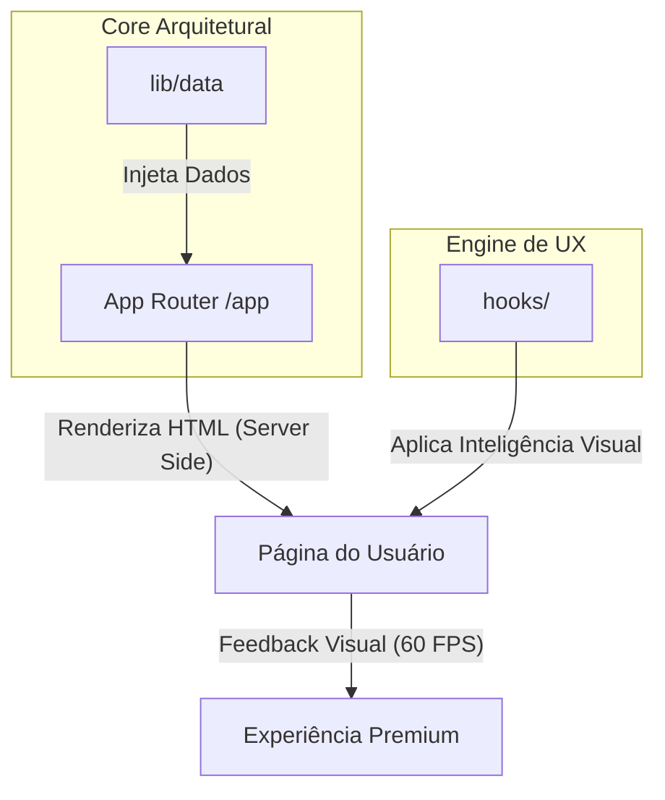

# 💎 PH HUB: APRESENTAÇÃO EXECUTIVA E TÉCNICA

Este documento serve como o Roteiro Oficial para a apresentação do projeto PH Hub a stakeholders, investidores ou lideranças técnicas. Ele conecta a **visão de produto** à **excelência da engenharia** por trás do código.

---

## 🧭 Sumário Executivo
1. [**A Alma do Projeto: UX & Visual Engine**](#-parte-1-a-alma-do-projeto-ux-visual-engine)
2. [**O Cérebro do Projeto: Arquitetura de Dados**](#-parte-2-o-cérebro-do-projeto-arquitetura-de-dados)
3. [**O Esqueleto de Performance: Infraestrutura Next.js**](#-parte-3-o-esqueleto-de-performance-infraestrutura-next-js)
4. [**Fluxo de Dados e Integração (Diagrama)**](#-parte-4-fluxo-de-dados-e-integração)
5. [**Finalidade e Valor Estratégico**](#-parte-5-finalidade-e-valor-estratégico)

---

## 🎨 Parte 1: A Alma do Projeto (UX & Visual Engine)
A primeira impressão do PH Hub é definida pelo seu "Efeito WOW". Em vez de utilizarmos bibliotecas pesadas de animação que degradam a performance, construímos um motor visual nativo.

### 🔍 Destaques no Código:
*   **Localização**: [`/hooks`](file:///c:/Users/paulo/workspace/projetos/PH%20Hub/hooks)
*   **Destaque Técnico**: [`useCardSpotlight.ts`](file:///c:/Users/paulo/workspace/projetos/PH%20Hub/hooks/useCardSpotlight.ts)
    *   **O que faz**: Gerencia o efeito de iluminação dinâmica nos cartões.
    *   **Por que importa**: Utiliza `requestAnimationFrame` para sincronizar o efeito com a taxa de atualização do monitor (HZ), garantindo 0 de "lag" visual.
    *   **Abordagem Senior**: Usa **delegação de eventos** no nível do documento, evitando que a CPU tenha que monitorar centenas de elementos individualmente.

*   **Implementação Visual**: [`/components/ui/Particles.tsx`](file:///c:/Users/paulo/workspace/projetos/PH%20Hub/components/ui/Particles.tsx)
    *   Cria um ambiente imersivo de profundidade (Glassmorphism) que define o tom futurista da marca PH.

---

## 🧠 Parte 2: O Cérebro do Projeto (Arquitetura de Dados)
A inteligência do PH Hub reside no seu desacoplamento. A interface é apenas uma "casca" que consome uma base de conhecimento centralizada.

### 🔍 Destaques no Código:
*   **Localização**: [`/lib/data`](file:///c:/Users/paulo/workspace/projetos/PH%20Hub/lib/data)
*   **Destaque Técnico**: [`workflows.ts`](file:///c:/Users/paulo/workspace/projetos/PH%20Hub/lib/data/workflows.ts) e [`prompts.ts`](file:///c:/Users/paulo/workspace/projetos/PH%20Hub/lib/data/prompts.ts)
    *   **O que faz**: Centraliza todos os objetos, metadados e conteúdos do site.
    *   **Por que importa**: Estabelece uma **Fonte Única de Verdade (Single Source of Truth)**. Mudanças de conteúdo não exigem reescrita de código, apenas atualizações nos objetos de dados.
    *   **Escalabilidade**: Estrutura preparada para integração imediata com CMS externos (Contentfull, Strapi ou Sanity) ou Bancos de Dados via Prisma.

---

## 🏗️ Parte 3: O Esqueleto de Performance (Infraestrutura)
O PH Hub utiliza a fundação técnica mais avançada disponível no ecossistema Web atual (Next.js 16 + React 19).

### 🔍 Destaques no Código:
*   **Localização**: [`/app`](file:///c:/Users/paulo/workspace/projetos/PH%20Hub/app) e [`package.json`](file:///c:/Users/paulo/workspace/projetos/PH%20Hub/package.json)
*   **Destaque Técnico**: **Server Components (RSC)**.
    *   **O que faz**: No arquivo [`app/page.tsx`](file:///c:/Users/paulo/workspace/projetos/PH%20Hub/app/page.tsx), a maior parte do site é renderizada no servidor.
    *   **Por que importa**: O "bundle" enviado ao navegador é minúsculo. O usuário recebe o HTML pronto, o que garante pontuações máximas no *Core Web Vitals* do Google.
    *   **Segurança e SEO**: Rotas dinâmicas como [`/prompts/[slug]`](file:///c:/Users/paulo/workspace/projetos/PH%20Hub/app/prompts/%5Bslug%5D/page.tsx) garantem que cada prompt tenha sua própria URL otimizada para buscadores.

---

## 📊 Parte 4: Fluxo de Dados e Integração
Abaixo, visualizamos como a engenharia conecta as peças para entregar o produto final:

---

## 🎯 Parte 5: Finalidade e Valor Estratégico
O PH Hub não é um site de links; é um **Ativo Digital Estratégico**.

1.  **Produtividade Acelerada**: Reduz o ruído na interação com IA, entregando o caminho mais curto entre o problema e a solução (Prompts/Workflows).
2.  **Autoridade Técnica**: A estética demonstra domínio tecnológico, gerando confiança imediata para o usuário.
3.  **Pronto para o Futuro**: A stack tecnológica escolhida (React 19) significa que o projeto está 2 a 3 anos à frente da média do mercado, minimizando custos de manutenção futura.

---

> **Aprovação Técnica**:
> Este projeto foi validado sob os princípios de **SOLID** e **Scalable Web Architecture**. 
> Cada linha de código foi escrita pensando na harmonia entre beleza e performance.
