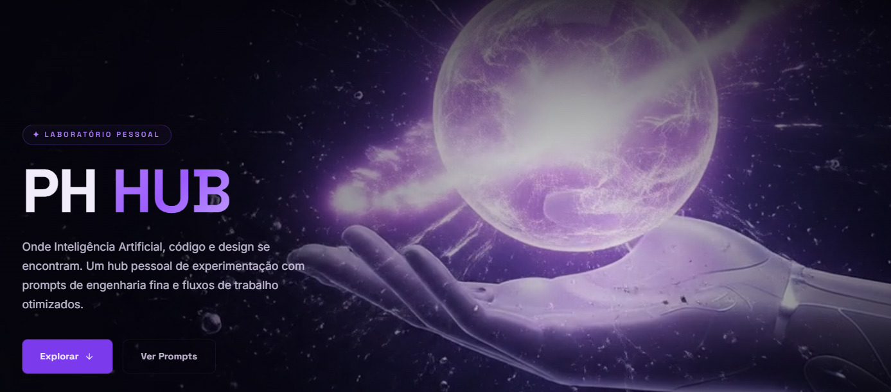

<div align="center">



<br/>

# PH HUB

**Onde Inteligência Artificial, código e design se encontram.**

[](https://nextjs.org/)
[](https://react.dev/)
[](https://www.typescriptlang.org/)
[](#-design-system)

</div>

---

## 🧬 Sobre o Projeto

O **PH Hub** é um laboratório pessoal de experimentação técnica — um hub centralizado para publicação de **prompts de engenharia fina**, curadoria de **ferramentas de IA** e automação de **fluxos de trabalho modernos**.

Originalmente concebido como uma página estática, foi totalmente reconstruído sobre **Next.js 16** com App Router, trazendo renderização híbrida (Server/Client Components), performance otimizada e uma identidade visual futurista baseada em **Glassmorphism** e animações procedurais.

**Veja mais:**

> [**Apresentação do HUB**](https://github.com/PauloHenrrq/PH-Hub/edit/main/PRESENTATION.md)  
> [**Documentação**](https://github.com/PauloHenrrq/PH-Hub/blob/main/DOC_ARQUITETURA.md)  

---

## ✨ Funcionalidades

| Módulo | Descrição |
| :--- | :--- |
| 🔧 **Workflows** | 19 fluxos de trabalho automatizados (`/init`, `/build`, `/gate`, `/commit`, `/chat`, `/experience`, `/po`, `/governance`, etc.) com visualização por slug dinâmico |
| 🧬 **Frameworks & Skills** | Metodologias de engenharia agêntica (GSD-Core, Ponytail, Caveman, Superpowers, OpenSpec, DSPy, LangGraph e Behavior Core & Skills Ecosystem) |
| 📝 **Prompts** | Biblioteca de prompts de engenharia fina com sistema de cópia rápida e suporte bilíngue (PT-BR / EN) |
| 🛠️ **Tools & CLIs** | Curadoria de ferramentas de IA, IDEs agênticas e variantes de linha de comando diretas (`gh`, `playwright`, `neonctl`, `psql`) |
| 🌐 **MCPs** | Catálogo de Model Context Protocols com comparativo de 2ª opção em Modo Direto (CLI sem overhead de tokens) |
| 🎨 **Design System** | Identidade visual unificada com partículas animadas, efeito spotlight e glassmorphism |

---

## 🚀 Stack Técnico

<div align="center">

| Camada | Tecnologia | Propósito |
| :---: | :--- | :--- |
| **Core** | Next.js 16 (App Router) + React 19 | Renderização híbrida e roteamento |
| **Linguagem** | TypeScript 5 | Integridade de dados e clareza estrutural |
| **Estilização** | Vanilla CSS + CSS Modules + Design Tokens | Controle total e zero dependência externa |
| **Performance** | Server Components + `requestAnimationFrame` | Bundle mínimo e animações fluidas |
| **SEO & A11y** | Metadados avançados + ARIA | Indexação e acessibilidade |

</div>

---

## 📁 Arquitetura do Projeto

<details>
<summary><strong>🚀 app/</strong> — Rotas & Páginas (App Router)</summary>

```
app/
├── layout.tsx                # Layout global — Providers, Navbar, Footer
├── page.tsx                  # Home — Orquestração de todas as Sections
├── globals.css               # Design Tokens, variáveis HSL e reset global
├── page.module.css           # Estilos isolados da Home
├── workflows/
│   ├── page.tsx              # Listagem completa de Workflows
│   └── [slug]/page.tsx       # Página individual de cada Workflow
├── prompts/
│   ├── page.tsx              # Listagem completa de Prompts
│   └── [slug]/page.tsx       # Página individual de cada Prompt
├── tools/page.tsx            # Listagem completa de Ferramentas
└── mcps/page.tsx             # Listagem completa de MCPs
```

</details>

<details>
<summary><strong>🧱 components/</strong> — Biblioteca de Interface</summary>

<details>
<summary>&nbsp;&nbsp;&nbsp;&nbsp;<code>layout/</code> — Estrutura global permanente</summary>

```
├── Navbar.tsx                # Navegação principal com transparência
└── Footer.tsx                # Rodapé com copyright
```

</details>

<details>
<summary>&nbsp;&nbsp;&nbsp;&nbsp;<code>sections/</code> — Blocos modulares da Home</summary>

```
├── HeroSection.tsx           # Banner principal + CTA
├── AboutSection.tsx          # Propósito do PH Hub
├── WorkflowsSection.tsx      # Vitrine de workflows
├── ToolsSection.tsx          # Grid de ferramentas
├── PromptsSection.tsx        # Galeria de prompts
├── McpsSection.tsx           # Seção de protocolos MCP
└── CtaSection.tsx            # Call-to-Action final
```

</details>

<details>
<summary>&nbsp;&nbsp;&nbsp;&nbsp;<code>ui/</code> — Design System atômico</summary>

```
├── McpCard.tsx               # Card com efeito hover para MCPs
├── ToolCard.tsx              # Card padronizado para ferramentas
├── Carousel.tsx              # Navegação horizontal com controles
├── Particles.tsx             # Fundo animado com partículas
├── EnergyConnector.tsx       # Decoração visual "neural"
└── ScrollToTop.tsx           # Botão de retorno ao topo
```

</details>

<details>
<summary>&nbsp;&nbsp;&nbsp;&nbsp;<code>prompt/</code> — Componentes da feature Prompts</summary>

```
├── PromptClient.tsx          # Lógica client-side do prompt
├── PromptView.tsx            # Visualização detalhada
└── CopyPromptBtn.tsx         # Botão de cópia com feedback
```

</details>

<details>
<summary>&nbsp;&nbsp;&nbsp;&nbsp;<code>workflow/</code> — Componentes da feature Workflows</summary>

```
└── WorkflowClient.tsx        # Client wrapper para Workflows
```

</details>

</details>

<details>
<summary><strong>💾 lib/</strong> — Camada de Dados</summary>

```
lib/data/
├── workflows.ts              # Catálogo de todos os Workflows
├── prompts.ts                # Base de prompts (PT-BR / EN)
├── tools.ts                  # Catálogo de ferramentas de IA
└── mcps.ts                   # Catálogo de protocolos MCP
```

</details>

<details>
<summary><strong>🧠 hooks/</strong> — Lógica de UX Reutilizável</summary>

```
hooks/
├── useCardSpotlight.ts       # Efeito de luz que segue o cursor
└── useRevealEngine.ts        # Animações de revelação por scroll
```

</details>

<details>
<summary><strong>📦 public/</strong> — Ativos Estáticos</summary>

```
public/
├── images/                   # Imagens do projeto
└── videos/                   # Vídeos demonstrativos
```

</details>

---

## 🎨 Design System

A identidade visual do PH Hub foi construída sobre três pilares:

- **Glassmorphism** — Superfícies translúcidas com blur e bordas sutis que criam profundidade.
- **Design Tokens em HSL** — Paleta de cores centralizada em variáveis CSS para troca de tema instantânea.
- **Micro-Animações Procedurais** — Partículas, efeito spotlight nos cards e revelação progressiva controlados via `requestAnimationFrame` e hooks customizados, sem dependência de bibliotecas externas de animação.

---

## 🛠️ Como Executar

### Pré-requisitos

- **Node.js** v20 ou superior
- **npm** ou **yarn**

### Instalação

```bash
# 1. Clone o repositório
git clone https://github.com/PauloHenrrq/PH-Hub.git
cd PH-Hub

# 2. Instale as dependências
npm install

# 3. Inicie o servidor de desenvolvimento
npm run dev
```

Acesse **`http://localhost:3000`** e explore a experiência.

---

## 🧩 Padrões Arquiteturais

| Padrão | Aplicação no Projeto |
| :--- | :--- |
| **Server Components** | Páginas e layouts renderizados no servidor para SEO e performance |
| **Client Components** | Interações (spotlight, scroll, cópia) isoladas com `"use client"` |
| **Data Layer** | Conteúdo centralizado em `lib/data/` — desacoplado da UI |
| **Feature Components** | Componentes especializados agrupados por domínio (`prompt/`, `workflow/`) |
| **CSS Modules** | Estilos com escopo isolado para evitar colisões |
| **Custom Hooks** | Lógica visual complexa extraída em hooks reutilizáveis |

---

## 📄 Licença & Contato

Este é um laboratório pessoal de experimentação técnica. Feedbacks e insights sobre engenharia de prompts são sempre bem-vindos via **Issues** ou **Discussões**.

<div align="center">

Criado com propósito por **Paulo Henrique** ◈

</div>
